# Penetration Test Report: Enigma (Authorized Lab)

**Prepared by:** Natapat Suebsubanant  
**Assessment type:** Black-box-inspired lab penetration test (externally initiated)  
**Assessment date:** 12 November 2026  
**Client/environment:** Hack The Box: *Enigma*, authorized training environment  
**Report version:** 1.0  
**Classification:** Training / Portfolio Draft: No real production client represented

> **Publication note:** This report is written in the format of a professional client deliverable, but it documents an HTB lab, not a commissioned production engagement. Verify HTB write-up/publication eligibility before sharing publicly. Credentials, password hashes, exact flag values, and private SSH keys are intentionally omitted. Hostnames and attack methodology may still constitute machine spoilers.

---

## 1. Executive Summary

The assessment demonstrated a chain of security weaknesses that progressed from externally accessible file-sharing and email services to application administrator access, server-side PHP execution, compromise of a local Linux account, and command execution through an internal management service with the ability to disclose a root-protected file.

The initial access path began with an NFS export containing an onboarding document with active mail credentials. Credential reuse enabled a second mailbox compromise, which exposed a management portal and administrative login information. A vulnerable OpenSTAManager module-update workflow then allowed an authenticated administrator to upload server-executable PHP, establishing code execution as the `www-data` account.

Subsequent access to application configuration and the database exposed a bcrypt password hash for local user `haris`. The hash was cracked offline and the recovered password was shown to work for the corresponding Linux account. With that foothold, SSH port forwarding exposed a localhost-only OliveTin interface. An injection in its database-backup action resulted in disclosure of `/root/root.txt`.

**Overall risk rating: Critical (lab context).** The overall rating describes the demonstrated *chained outcome*. Individual vulnerabilities have distinct prerequisites and are assessed separately below.

### Confirmed outcomes

- Exposed internal onboarding material was accessed over NFS.
- Two mailboxes were accessed using a reused password.
- The management portal was accessed with credentials found in email.
- Uploaded PHP executed under `uid=33(www-data)`.
- A recovered application password authenticated to the Linux account `haris` (`uid=1000`).
- The user-flag file was located with group-readable permissions.
- Internal OliveTin version `3000.10.0` was accessed through an SSH local port forward.
- A crafted `password` field in OliveTin's database-backup action produced the contents of a root-protected file.

**Limitations:** The available evidence confirms a root-sensitive file disclosure, **not** a separately obtained persistent root shell. The user flag value was not captured in the provided transcript, although its location and Haris read permission were verified.

---

## 2. Scope, Rules, and Methodology

### Scope

| Asset | Role / observation |
|---|---|
| `10.129.170.71` | Target IP during final lab session; dynamically assigned by HTB |
| `enigma.htb` | Primary target hostname |
| `mail001.enigma.htb` | Roundcube webmail endpoint |
| `support_001.enigma.htb` | OpenSTAManager management portal |
| `127.0.0.1:1337` (on target) | OliveTin management interface, reached through SSH forwarding |
| `/srv/nfs/onboarding` | Network filesystem export observed during enumeration |

### Methodology

The tester followed an evidence-driven workflow modeled on common penetration-testing phases:

1. Network reconnaissance and service identification.
2. Service-specific enumeration and sensitive-information discovery.
3. Authentication and authorization testing.
4. Controlled validation of application code execution.
5. Post-exploitation enumeration and credential exposure assessment.
6. Linux-account compromise validation.
7. Internal management-service exposure and command-injection validation.
8. Documentation of findings, impact, and remediation.

Testing took place in an authorized isolated HTB environment. No production assets were assessed. Some command lines are preserved in the companion learning walkthrough; this report limits exploit implementation details where they would add little to the risk assessment.

---

## 3. Risk Summary

| ID | Finding | Severity | Verified impact |
|---|---|---|---|
| ENG-01 | Sensitive employee credentials in broadly accessible NFS export | **High** | Valid webmail credentials disclosed |
| ENG-02 | Mail credential reuse and exposed management credentials | **High** | Additional mailbox and admin portal access |
| ENG-03 | Authenticated arbitrary PHP upload in OpenSTAManager | **Critical** in context | Web-server command execution as `www-data` |
| ENG-04 | Application database/hash exposure and password reuse with Linux account | **High** | Valid interactive Linux account `haris` |
| ENG-05 | OliveTin command injection in a management action | **Critical** | Root-protected file disclosed |

**Severity rationale:** Ratings reflect business-style impact in this single-host training lab, not a formal CVSS calculation for every environment-specific misconfiguration. The advisory associated with ENG-03 lists CVSS 7.2 (High), and the OliveTin advisory for ENG-05 lists CVSS 9.9 (Critical). The effective impact of ENG-03 in this lab is raised by the subsequent chained compromise; the underlying product CVSS is not being redefined.

---

## 4. Attack Path: High-Level Narrative

```mermaid
flowchart LR
    A[Exposed NFS share] --> B[Onboarding credentials]
    B --> C[Webmail access + password reuse]
    C --> D[Management admin access]
    D --> E[OpenSTAManager PHP execution]
    E --> F[DB access + password hash]
    F --> G[Linux user Haris]
    G --> H[SSH tunnel to internal OliveTin]
    H --> I[Command injection]
    I --> J[Root-sensitive data disclosure]
```



Every transition above was supported by a direct observation in the session. The diagram represents a **single demonstrated path**, not an exhaustive list of all possible attack routes.

---

## 5. Detailed Findings

### ENG-01: Sensitive credentials exposed through NFS onboarding share

**Severity:** High  
**Category:** Sensitive information exposure / excessive network share access  
**Affected service:** NFS on TCP/2049 and RPC-related ports  
**Affected path:** `/srv/nfs/onboarding`

**Description**  
NFS enumeration returned a share export permitting broad client access. The tester successfully mounted the onboarding export in read-only mode and viewed a new-employee access document containing usable mail credentials and the Roundcube host.

**Evidence**

```text
showmount -e <target>
/srv/nfs/onboarding *
```

Representative access command used in the lab:

```bash
sudo mount -v -t nfs \
  -o ro,vers=3,proto=tcp,mountproto=tcp \
  <TARGET_IP>:/srv/nfs/onboarding /mnt/enigma-nfs
```

An onboarding PDF supplied working mail access information. Exact credentials are redacted.

**Impact**  
An unauthorized party with network reachability to the share could obtain confidential onboarding information and credentials, providing an initial access path to additional services.

**Recommendations**

1. Limit NFS exports to explicitly authorized IPs or trusted management segments; avoid wildcard client authorization where possible.
2. Enforce filesystem permissions appropriate to the sensitivity of the stored material.
3. Remove passwords and other active secrets from static onboarding documents; use secure enrollment or expiring invitation mechanisms.
4. Rotate credentials that may already have been exposed and review file-access logging.

**Suggested verification**  
From an unapproved lab source, verify that the export cannot be mounted and that credential-bearing documents are no longer reachable.

---

### ENG-02: Reused webmail password and administrative credentials stored in email

**Severity:** High  
**Category:** Weak credential hygiene / insecure secret distribution  
**Affected services:** Roundcube and management portal

**Description**  
Credentials obtained from onboarding successfully authenticated to Kevin's Roundcube mailbox. The same password also authenticated to Sarah's mailbox. A message in Sarah's inbox revealed the hostname of an internal management application and corresponding administrative credentials, which were used successfully.

**Evidence**

- Working Roundcube access to the employee mailbox.
- Successful access to the second mailbox with a reused credential.
- Message revealing `support_001.enigma.htb` and administrative access information.
- Successful administrative access to OpenSTAManager 2.9.8.

No mail-body screenshots or passwords are reproduced because they contain sensitive data.

**Impact**  
Compromise of a single exposed password was expanded to a separate employee account. Administrative credentials in email subsequently allowed access to a high-risk management feature. The resulting privilege chain greatly exceeded the expected scope of the original mailbox.

**Recommendations**

1. Enforce unique passwords and multi-factor authentication for employee and administrative access.
2. Prohibit long-lived administrative credentials in ordinary email; distribute secrets via managed, expiring channels.
3. Rotate exposed credentials and investigate cross-account authentication logs.
4. Apply least-privilege administrative roles and alert on unusual mailbox access patterns.

**Suggested verification**  
Confirm that separately provisioned employee accounts no longer share secrets and that management access requires independent, appropriately privileged authentication.

---

### ENG-03: OpenSTAManager module-update upload permits server-side PHP execution

**Severity:** Critical (effective impact in lab chain; associated advisory base severity High)  
**Category:** CWE-434: Unrestricted Upload of File with Dangerous Type  
**Affected application:** OpenSTAManager 2.9.8  
**Reference:** CVE-2026-38751 / GHSA-rm34-fg4m-39mw  
**Prerequisite:** Administrative access to the module/update workflow

**Description**  
After authenticating to the OpenSTAManager administration panel, the tester uploaded a ZIP containing a PHP file via the Tools → Updates module workflow. Extracted content became accessible under the web application's `/modules/` path. A benign marker proved that the PHP was served and executed, followed by a read-only process identity check.

**Evidence**

The marker test displayed:

```text
ENIGMA_LAB_PROBE_OK
```

A subsequent identity check returned:

```text
uid=33(www-data) gid=33(www-data) groups=33(www-data)
www-data
/var/www/html/openstamanager/modules/run
```

A later test established a reverse shell in the same execution context. The evidence above is sufficient to demonstrate server-side command execution.

**Impact**  
An administrator-level attacker could place executable code into the web application and run OS commands with the web-server account's permissions. In the demonstrated chain, this exposed application configuration and database access, enabling further credential compromise.

**Recommendations**

1. Upgrade to a vendor-remediated version when available and monitor the official advisory.
2. Limit module-update access to strictly necessary administrators; require MFA and approval where appropriate.
3. Validate module archives, permitted file types, canonical extraction paths, and signatures; reject unexpected executable content.
4. Store uploaded archives outside executable web roots and prevent dynamic script execution in extraction locations.
5. Run the web server under a tightly confined account without access to unnecessary application secrets or OS resources.

**Suggested verification**  
Attempt a harmless marker-file upload as an authorized test user after remediation; ensure it cannot be executed or reached as server-side code.

---

### ENG-04: Readable application secrets and reusable hashed password enabled Linux user compromise

**Severity:** High  
**Category:** Credential exposure / insufficient separation of identities / weak password  
**Affected components:** OpenSTAManager configuration and database, Linux user `haris`

**Description**  
With `www-data` execution, the tester located the effective application configuration in `config.inc.php`, retrieved database connection settings, and queried the application account table `zz_users`. Haris's password field was a 60-character bcrypt string beginning `$2y$10$`. Its password was successfully recovered using an offline wordlist attack. The same recovered password authenticated to the **Linux** account `haris`.

This finding is **not** that bcrypt itself is broken. The risk comes from exposure of password hashes, selection of a guessable password, and password reuse between an application account and an OS login.

**Evidence**

```text
Table: zz_users
Columns included: username, password, idgruppo, enabled
Hash type: bcrypt-style $2y$10$ prefix, 60 characters
```

Local account validation:

```text
su - haris -c 'id'
uid=1000(haris) gid=1000(haris) groups=1000(haris),100(users)
```

Haris's home directory contained:

```text
-rw-r----- 1 root haris 33 ... user.txt
```

The user flag value itself was not retained in the supplied transcript.

**Impact**  
Server-side code execution was extended into a separate operating-system user context. The attacker gained access to user-owned resources and could establish authenticated SSH connectivity after installing an authorized public key.

**Recommendations**

1. Restrict read access to the runtime configuration and secrets to the minimum necessary accounts.
2. Apply least privilege to application database credentials; separate application data access from credential-administration rights.
3. Require long, unique passwords; prohibit password reuse across web apps and operating-system accounts.
4. Apply MFA or SSH key-only access for privileged administration, wherever suitable.
5. Monitor database exports, unusual credential queries, and account-switching events.
6. Review whether application password hashes must be accessible to the compromised application runtime; minimize exposure and use appropriate credential stores.

**Suggested verification**  
Confirm that unauthorized application processes cannot read unrelated account hashes or gain lateral access to Unix identities through shared passwords.

---

### ENG-05: OliveTin shell-mode command injection disclosed root-protected file

**Severity:** Critical  
**Category:** CWE-78: OS Command Injection  
**Affected application:** OliveTin `3000.10.0`  
**Affected action:** Backup Database / Password field  
**Reference:** CVE-2026-27626 / GHSA-49gm-hh7w-wfvf  
**Reachability:** Target-local port 1337; accessed over an SSH tunnel from the compromised Haris account

**Description**  
The tester identified OliveTin on the target and accessed its management dashboard by tunneling local Kali port 1337 to the target's `127.0.0.1:1337`. The dashboard version was `3000.10.0`. The Backup Database action accepted a crafted Password value containing shell metacharacters. The resulting execution output contained the contents of `/root/root.txt`.

The demonstrated mechanism corresponds to the password-argument shell-safety weakness described by CVE-2026-27626. The vendor advisory identifies versions up to and including 3000.10.0 as affected and 3000.10.1 as patched.

**Evidence**

```text
Observed web interface: OliveTin 3000.10.0
Observed action: Backup Database
Execution status: Completed
Output: mysqldump warning/usage text, then a 32-character root flag
```

**Impact**  
An attacker who could reach and invoke the affected management action was able to execute injected shell syntax in the OliveTin action context, leading to disclosure of a root-sensitive file. Depending on OliveTin's execution identity and system permissions, arbitrary command execution could permit broader compromise. This assessment did not separately validate a persistent root shell.

**Important scope note:** The tester accessed the internal service through SSH. The evidence does not establish unauthenticated exposure of this action to the public internet.

**Recommendations**

1. Upgrade to a version including the vendor's fix (the original advisory lists `3000.10.1` as patched); validate against current release/security guidance.
2. Do not embed untrusted Password-field values into shell-evaluated command strings. Prefer argument-vector execution without a shell.
3. Apply strict argument-type validation and reject shell metacharacters where input must not contain them.
4. Restrict dashboard access, enforce authorization per action, and disable unnecessary actions.
5. Run OliveTin with minimum required filesystem privileges; a backup action should not be able to read unrelated root-only files.
6. Audit management-action execution logs and retest both the original password-field injection and any webhook-related entry points noted in the vendor advisory.

**Suggested verification**  
Submit a harmless command-injection test string through the affected field after remediation and verify that it remains literal data, with no secondary OS command executed.

---

## 6. Evidence Register

The following evidence references describe items captured or observed during the lab. Attach original screenshots/terminal outputs to the final client evidence package if needed.

| Evidence ID | Artifact | Establishes |
|---|---|---|
| E-01 | Nmap service discovery output | Exposed SSH, HTTP, POP3/IMAP, RPC/NFS |
| E-02 | `showmount -e` and NFS mount outcome | Broad NFS export and accessible onboarding material |
| E-03 | `New_Employee_Access.pdf` and successful Roundcube access | Employee secrets in shared material |
| E-04 | Mailbox observation (sanitized) | Password reuse and management portal credential disclosure |
| E-05 | OpenSTAManager admin interface / module upload | Validated upload workflow |
| E-06 | PHP marker and `id` output | Executable server-side PHP as `www-data` |
| E-07 | Config/query output (sanitized) | Access to database credentials, `zz_users`, bcrypt hash |
| E-08 | John result (sanitized) and `su - haris -c 'id'` | Offline crack and account-password reuse |
| E-09 | `ls -la /home/haris` | User flag location and access rights |
| E-10 | OliveTin dashboard screenshot | Version `3000.10.0`, reachable through port forwarding |
| E-11 | OliveTin execution-results screenshot | Injection-driven root-sensitive file disclosure |

**Evidence caveat:** The transcript contains full detail for E-06 onward and earlier summarized observations for E-01 through E-05. Before external use, verify the exact availability and timestamps of original supporting artifacts. Do not fabricate missing screenshots.

---

## 7. Prioritized Remediation Plan

| Priority | Action | Intended risk reduction |
|---|---|---|
| **P0: Immediate** | Remove active credentials from public/broad NFS shares; rotate exposed accounts | Break initial access chain |
| **P0: Immediate** | Remediate or disable vulnerable module update and OliveTin injection paths | Prevent application/server execution |
| **P0: Immediate** | Rotate affected admin and reused credentials | Break access propagation and lateral movement |
| **P1: Short term** | Enforce unique passwords, MFA, and secure secret distribution | Reduce cross-account compromise |
| **P1: Short term** | Minimize runtime access to configuration, DB hashes, and root-owned data | Reduce post-exploitation impact |
| **P1: Short term** | Restrict access to internal management endpoints and apply per-action authorization | Reduce attack surface |
| **P2: Continuous** | Add configuration reviews, exposure scans, alerting, and regression tests | Detect recurrence |

Retesting should verify controls across the *entire chain*, not only individual fixes.

---

## 8. Limitations and Qualifications

- Assessment was performed against a deliberately vulnerable HTB system; findings must not be represented as vulnerabilities at a real client.
- The target IP was dynamically allocated and may not remain the same.
- Some earlier reconnaissance and mailbox actions are known from session notes rather than preserved verbatim screenshots.
- Exact admin/employee credentials, application DB passwords, recovered password hashes, and both flags are redacted.
- There was no confirmation of broad exploitability against unrelated software versions or infrastructure.
- No separate persistent root shell was demonstrated, and user-flag *contents* were not observed in the supplied transcript.
- OliveTin authentication configuration, exact underlying action template, service process UID, and internet-facing accessibility were not independently established. The file read outcome is directly evidenced.

---

## 9. Conclusion

The Enigma assessment demonstrated that **small configuration and identity-management failures can compound into a complete attack path**. A broadly readable onboarding document led to mailbox access; reused secrets exposed administrative credentials; a dangerous upload feature provided web-server code execution; accessible hashes and further password reuse enabled a Linux account pivot; and a vulnerable internal management action provided a route to protected data.

The key security lesson is to apply **defense in depth**: restrict network shares, avoid distributing durable credentials through static files/email, require unique identities and MFA, harden upload features, confine application/database privileges, and remove shell interpolation from automation interfaces. Fixing any major link in the demonstrated chain would have limited or interrupted progression.

---

## 10. References

- OpenSTAManager arbitrary file upload, CVE-2026-38751: https://github.com/advisories/GHSA-rm34-fg4m-39mw
- OliveTin command injection, CVE-2026-27626 (vendor advisory): https://github.com/OliveTin/OliveTin/security/advisories/GHSA-49gm-hh7w-wfvf
- NVD OliveTin CVE record: https://nvd.nist.gov/vuln/detail/CVE-2026-27626
- CWE-434: Unrestricted Upload of File with Dangerous Type: https://cwe.mitre.org/data/definitions/434.html
- CWE-78: OS Command Injection: https://cwe.mitre.org/data/definitions/78.html
- OWASP Web Security Testing Guide: https://owasp.org/www-project-web-security-testing-guide/

---

*End of assessment report.*
